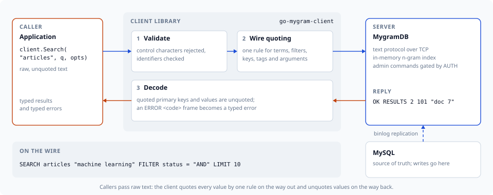
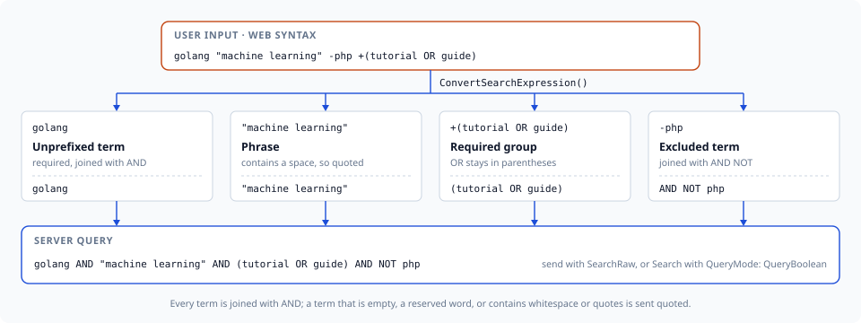

# go-mygram-client

[](https://github.com/libraz/go-mygram-client/actions)
[](https://pkg.go.dev/github.com/libraz/go-mygram-client)
[](https://codecov.io/gh/libraz/go-mygram-client)
[](LICENSE)
[](https://go.dev/)
[](https://golangci-lint.run/)
[](https://pkg.go.dev/github.com/libraz/go-mygram-client?tab=imports)

Go client library for [MygramDB](https://github.com/libraz/mygram-db/) — a high-performance in-memory full-text search engine with MySQL replication support.

**Server compatibility:** MygramDB 1.6 or later, with the protocol implemented through 1.12.0. A server rejects options it predates, and an older server's `ERROR` frames carry no numeric code; the [API reference](docs/en/api-reference.md) marks each option that needs a newer server.



## Overview

MygramDB answers full-text queries from memory instead of an on-disk MySQL FULLTEXT index. How much that gains depends on the query and the dataset; the [published benchmarks](https://mygramdb.libraz.net/benchmarks) give the numbers together with the conditions they were measured under. This client communicates via MygramDB's TCP text protocol (memcached-style) with zero external dependencies.

| | MySQL FULLTEXT | MygramDB |
|---|---|---|
| **Search Speed** | Baseline | [Measured](https://mygramdb.libraz.net/benchmarks) |
| **Storage** | On-disk | In-memory |
| **Replication** | — | MySQL binlog |
| **Protocol** | MySQL | TCP (memcached-style) |

### Features

- **Zero Dependencies** — Standard library only
- **Context Support** — All methods have `context.Context` variants
- **Search Expression Parser** — Web-style search syntax (+required, -excluded, "phrase", OR, grouping)
- **Full Protocol Support** — All MygramDB commands (SEARCH, COUNT, GET, INFO, etc.)
- **Input Validation** — Built-in protection against control character and protocol-delimiter injection
- **Typed Errors** — Server `ERROR` frames carry a numeric `ErrorCode`; transient codes drive pool retries
- **Thread Safe** — Safe for concurrent use
- **Connection Pooling** — Bounded `Pool` with reconnection and retry for high-throughput workloads
- **Resilience** — Pool circuit breaker, observability events, TCP keep-alive, and client-level auto-reconnect
- **IPv4 and IPv6** — Connects to IPv6 literals (`"[::1]:11016"`) and to hostnames that resolve only to an AAAA record

## Installation

```bash
go get github.com/libraz/go-mygram-client
```

## Quick Start

```go
package main

import (
	"fmt"
	"log"

	mygram "github.com/libraz/go-mygram-client"
)

func main() {
	client := mygram.NewClient("localhost:11016")
	defer client.Close()

	if err := client.Connect(); err != nil {
		log.Fatal(err)
	}

	// Search
	resp, err := client.Search("articles", "hello", mygram.SearchOptions{
		Limit:      100,
		SortColumn: "created_at",
		SortDesc:   true,
	})
	if err != nil {
		log.Fatal(err)
	}
	fmt.Printf("Found %d results\n", resp.TotalCount)

	// Count
	count, err := client.Count("articles", "technology", mygram.CountOptions{})
	if err != nil {
		log.Fatal(err)
	}
	fmt.Printf("Count: %d\n", count.Count)

	// Get document by ID
	doc, err := client.Get("articles", "12345")
	if err != nil {
		log.Fatal(err)
	}
	fmt.Printf("Doc: %s %v\n", doc.PrimaryKey, doc.Fields)
}
```

## Connection Pooling

A single `Client` wraps one connection and serializes commands, so it handles
one request at a time. For concurrent workloads use a `Pool`, which lends out
many connections up to a fixed cap and adds transparent reconnection and retry.
It exposes the same command methods as `Client`, so it is a drop-in replacement.

```go
pool := mygram.NewPool(mygram.PoolConfig{
	ClientConfig:    mygram.ClientConfig{Host: "localhost", Port: 11016},
	MaxOpenConns:    16,               // hard cap on total connections
	MaxIdleConns:    8,                // connections kept for reuse
	ConnMaxLifetime: 30 * time.Minute, // recycle old connections
})
defer pool.Close()

// Safe to call from many goroutines; each call borrows a connection.
resp, err := pool.Search("articles", "hello", mygram.SearchOptions{Limit: 100})
```

When every connection is busy, a call blocks until one is returned or its
`context` is canceled — a natural backpressure signal. See
[Connection Pooling](docs/en/advanced-usage.md#connection-pooling)
for sizing, retry semantics, and monitoring.

## Search Expressions

`ConvertSearchExpression` turns web-style input into a server boolean query:
unprefixed terms and `+` terms are joined with `AND`, `-` terms become
`AND NOT`, and an OR chain stays in parentheses.



`Search` sends its query as literal text, so a boolean expression goes through
`SearchRaw`, or through `Search` with `QueryMode: mygram.QueryBoolean` when it
also needs filters, sorting, fuzzy matching or highlighting:

```go
raw, err := mygram.ConvertSearchExpression(`golang "machine learning" -php +(tutorial OR guide)`)
// raw == `golang AND "machine learning" AND (tutorial OR guide) AND NOT php`

resp, err := client.SearchRaw("articles", raw, mygram.SearchRawOptions{Limit: 50})

resp, err = client.Search("articles", raw, mygram.SearchOptions{
	QueryMode:  mygram.QueryBoolean,
	SortColumn: "created_at",
	SortDesc:   true,
	Highlight:  &mygram.HighlightOptions{},
})
```

In the default literal mode, plain user text keeps matching as a phrase. For
input without OR or grouping, `SimplifySearchExpression` splits it into a main
term plus AND/NOT terms for `Search`; it returns an error on OR or grouping, so
check with `HasComplexExpression` first when the input may contain either:

```go
parsed, err := mygram.ParseSearchExpression(userInput)
if err != nil {
	return err
}
if mygram.HasComplexExpression(parsed) {
	raw, _ := mygram.ConvertSearchExpression(userInput)
	resp, err = client.SearchRaw("articles", raw, mygram.SearchRawOptions{})
} else {
	expr, _ := mygram.SimplifySearchExpression(userInput)
	resp, err = client.Search("articles", expr.MainTerm, mygram.SearchOptions{
		AndTerms: expr.AndTerms,
		NotTerms: expr.NotTerms,
		Limit:    100,
		Filters:  map[string]string{"status": "published", "lang": "en"},
	})
}
```

## Search Features

### BM25 Relevance Scoring

Sort by relevance using the special `_score` sort column (requires
`verify_text: ascii|all` on the server):

```go
resp, _ := client.Search("articles", "machine learning", mygram.SearchOptions{
	SortColumn: "_score",
	SortDesc:   true,
	Limit:      10,
})
```

### Fuzzy Search (Levenshtein)

```go
resp, _ := client.Search("articles", "machne", mygram.SearchOptions{
	Fuzzy: 1, // match within 1 edit (or 2)
	Limit: 10,
})
```

### Highlighting

```go
resp, _ := client.Search("articles", "golang", mygram.SearchOptions{
	Highlight: &mygram.HighlightOptions{
		OpenTag:      "<strong>",
		CloseTag:     "</strong>",
		SnippetLen:   200,
		MaxFragments: 3,
	},
	SortColumn: "_score",
	SortDesc:   true,
})
for _, r := range resp.Results {
	fmt.Println(r.PrimaryKey, r.Snippet)
}
```

A zero-value `&mygram.HighlightOptions{}` enables highlighting with server
defaults (`<em>`/`</em>`, 100 code points, up to 3 fragments).

### Comparison Filters

`Filters` expresses equality only. `FilterConditions` adds the comparison
operators, and both forms may be combined on one request:

```go
resp, _ := client.Search("articles", "golang", mygram.SearchOptions{
	Filters: map[string]string{"status": "1"},
	FilterConditions: []mygram.FilterCondition{
		{Key: "views", Op: mygram.FilterGreaterThanOrEqual, Value: "100"},
		{Key: "created_at", Op: mygram.FilterLessThan, Value: "2026-01-01"},
	},
})
```

### Facets

Aggregate distinct filter-column values with document counts, optionally
scoped to a search result set, and page through them with `Limit`/`Offset`:

```go
// Top categories among documents matching "machine learning":
resp, _ := client.Facet("articles", "category", mygram.FacetOptions{
	Query:   "machine learning",
	Filters: map[string]string{"status": "1"},
	Limit:   10,
})
for _, v := range resp.Results {
	fmt.Printf("%s: %d\n", v.Value, v.Count)
}

page, _ := client.Facet("articles", "category", mygram.FacetOptions{Limit: 20, Offset: 40})
fmt.Printf("%d of %d categories\n", len(page.Results), page.TotalCount)
```

### Multi-database Tables

A server can index tables from more than one database. Reference a table as
`database.table`; bare names work on single-database servers.

```go
resp, _ := client.Search("app_db.articles", "hello", mygram.SearchOptions{Limit: 10})

id, _ := mygram.QualifyTableIdentity("articles", "app_db")  // "app_db.articles"
db, tbl, _ := mygram.ParseTableIdentity("app_db.articles")  // "app_db", "articles"
```

## Wire Quoting

Search terms, filter values, AND/NOT terms, highlight tags and primary keys
all go through one quoting decision: a value is quoted when it is empty, a
clause keyword (matched case-insensitively), or contains ASCII or Unicode
whitespace, a control character, a quote, a backslash, or a parenthesis.
Callers always pass raw, unquoted text; a highlight tag that needs quoting is
quoted rather than rejected. See
[Search Expressions](docs/en/search-expression.md#notes)
for the exact rule.

```go
// The full-width space stays inside one term.
resp, _ := client.Search("articles", "機械学習　チュートリアル", mygram.SearchOptions{})

// A filter value equal to a reserved keyword still matches literally.
resp, _ = client.Search("articles", "q", mygram.SearchOptions{
	Filters: map[string]string{"status": "AND"},
})
```

Quoted primary keys and `GET` string values are decoded on the way back, so a
`SEARCH` or `GET` result whose primary key or a string field contains a space
round-trips intact.

## Authentication and Error Codes

### Administrative Authentication

The server gates administrative commands (`DUMP`, `SYNC`, `REPLICATION`,
`CONFIG`, `CACHE`, `OPTIMIZE`, `DEBUG`, `SET`, `SHOW VARIABLES`) behind `AUTH`.
Set `ClientConfig.AdminToken` and the client sends `AUTH` on every connection,
including the ones opened by an auto-reconnect and by a `Pool`:

```go
pool := mygram.NewPool(mygram.PoolConfig{
	ClientConfig: mygram.ClientConfig{
		Host:       "localhost",
		Port:       11016,
		AdminToken: os.Getenv("MYGRAM_ADMIN_TOKEN"),
	},
})
```

A rejected token fails `Connect` with `ErrCodePermissionDenied`, so a
misconfigured token surfaces at startup. Ordinary search traffic needs no token.

### Typed Error Codes

Every `ERROR` frame carries a numeric code, exposed as `ServerError.Code`. The
pool retries the transient codes (`ErrCodeServerLoading`,
`ErrCodeServerNotReady`, `ErrCodeServerBusy`); others are returned as is:

```go
if _, err := client.Search("ghosts", "x", mygram.SearchOptions{}); err != nil {
	if code, ok := mygram.ServerErrorCode(err); ok && code == mygram.ErrCodeTableNotFound {
		// the table is not in the server's catalog
	}
}
```

### Readiness

```go
info, _ := client.Info()
if !info.Ready() {
	// the server is up but not yet serving queries
}
```

## Server Administration

### Replication Lag and Operation Deadlines

`GetReplicationStatus` reports `SecondsSinceLastApplied`, stamped where the
replication position advances, so it measures progress rather than
connectivity; the server reports -1 until the first event is applied. It is an
administrative command, so a server with a token configured needs `AdminToken`
to answer it. `DUMP LOAD`, `DUMP VERIFY` and `OPTIMIZE` use their own budgets
(`DumpLoadTimeoutMs`, `DumpVerifyTimeoutMs`, `OptimizeTimeoutMs`), leaving
`TimeoutMs` short enough to detect a stalled query:

```go
status, err := client.GetReplicationStatus()
if err == nil && status.SecondsSinceLastApplied > 60 {
	log.Printf("replication is %ds behind: %s", status.SecondsSinceLastApplied, status.LastError)
}
```

### Runtime Variables and On-demand Sync

```go
_ = client.SetVariable("logging.level", "info")
out, _ := client.ShowVariables("logging%")

_, _ = client.Sync("app_db.articles")
syncStatus, _ := client.SyncStatus()
_, _ = client.SyncStop("app_db.articles")
```

## Documentation

- [Getting Started](docs/en/getting-started.md) — install, configuration, and error handling
- [Search Expressions](docs/en/search-expression.md) — parse and convert web-style search input
- [API Reference](docs/en/api-reference.md) — every method, option, and type
- [Advanced Usage](docs/en/advanced-usage.md) — connection pooling, resilience, authentication, and error codes

Package-level API docs are on [pkg.go.dev](https://pkg.go.dev/github.com/libraz/go-mygram-client).

## Development

```bash
make test       # Run unit tests
make test-race  # Run unit tests with race detector
make test-e2e   # Run e2e tests against a live MygramDB server
make test-e2e-docker # Spin up MySQL + MygramDB (docker compose), run e2e, tear down
make lint       # Run golangci-lint
make fmt        # Format code
make coverage   # Generate coverage report
```

### End-to-end tests

`make test-e2e` exercises every public method against a running MygramDB
instance. Tests are gated by the `e2e` build tag, so the default
`go test ./...` (and CI) never connect to a server.

```bash
# Default: connect to 127.0.0.1:11016
make test-e2e

# Override the endpoint
MYGRAM_HOST=db.example.com MYGRAM_PORT=11016 make test-e2e

# Authenticate administrative commands (required by a server that
# binds to a non-loopback address)
MYGRAM_ADMIN_TOKEN=... make test-e2e

# Skip side-effect heavy suites
MYGRAM_E2E_SKIP_DUMP=1 MYGRAM_E2E_SKIP_REPLICATION=1 make test-e2e
```

If the server is unreachable, every e2e test is skipped (not failed).
Suites that mutate global server state (replication start/stop, cache
toggle, dump round-trip) restore the original state on exit.

#### Self-contained docker-compose stack

`make test-e2e-docker` brings up a throwaway **MySQL + MygramDB** stack (the
server is pulled from `ghcr.io/libraz/mygram-db`), seeds it with a deterministic
dataset, runs the e2e suite with `MYGRAM_E2E_SEEDED=1`, then tears everything
down. No local server is required. See [`e2e/docker/`](e2e/docker/README.md) for
knobs (`MYGRAMDB_VERSION`, `MYGRAM_ADMIN_TOKEN`, `KEEP_UP`, ports). The
`TestE2ESeeded` block asserts exact result sets (database-qualified identity,
phrase + required-filter visibility, Japanese ngram matching, `SearchRaw` OR,
facet counts and pagination, comparison filters, boolean query mode).

## License

[MIT](LICENSE)
