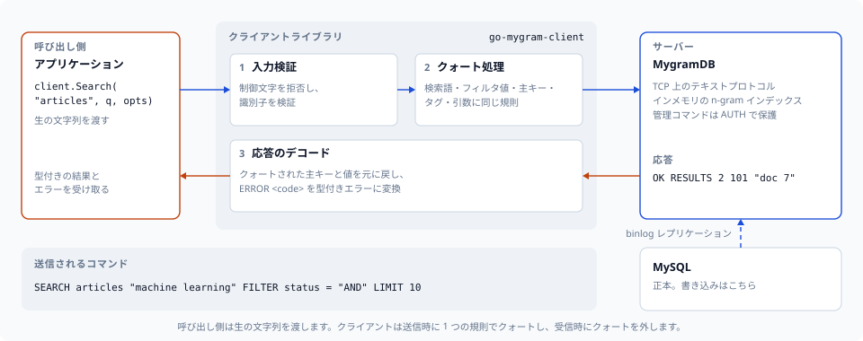
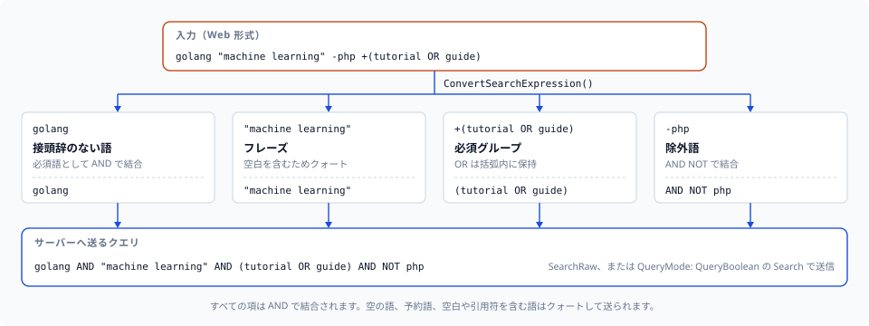

# go-mygram-client

[](https://github.com/libraz/go-mygram-client/actions)
[](https://pkg.go.dev/github.com/libraz/go-mygram-client)
[](https://codecov.io/gh/libraz/go-mygram-client)
[](LICENSE)
[](https://go.dev/)
[](https://golangci-lint.run/)
[](https://pkg.go.dev/github.com/libraz/go-mygram-client?tab=imports)

[MygramDB](https://github.com/libraz/mygram-db/) 用の Go クライアントライブラリです。MygramDB は MySQL レプリケーションに対応した高性能なインメモリ全文検索エンジンです。

**対応サーバー:** MygramDB 1.6 以降に対応し、1.12.0 までのプロトコルを実装しています。サーバーは自身より新しいオプションを拒否し、古いサーバーの `ERROR` には数値コードが付きません。新しいサーバーを必要とするオプションは [API リファレンス](docs/ja/api-reference.md)に明記しています。



## 概要

MygramDB は、ディスク上の MySQL FULLTEXT インデックスではなくメモリから全文検索に応答します。どれだけ速くなるかはクエリとデータセット次第で、実測値と測定条件は[公開ベンチマーク](https://mygramdb.libraz.net/ja/benchmarks)に載せています。本クライアントは MygramDB の TCP テキストプロトコル（memcached 形式）で通信し、外部依存はありません。

| | MySQL FULLTEXT | MygramDB |
|---|---|---|
| **検索速度** | 基準 | [実測値](https://mygramdb.libraz.net/ja/benchmarks) |
| **ストレージ** | ディスク | インメモリ |
| **レプリケーション** | — | MySQL binlog |
| **プロトコル** | MySQL | TCP（memcached 形式） |

### 特徴

- **依存ゼロ** — 標準ライブラリのみ
- **Context 対応** — すべてのメソッドに `context.Context` 版があります
- **検索式パーサー** — Web 形式の検索構文（+必須、-除外、"フレーズ"、OR、グループ化）
- **完全なプロトコル対応** — MygramDB の全コマンド（SEARCH、COUNT、GET、INFO など）
- **入力検証** — 制御文字とプロトコル区切り文字のインジェクションに対する組み込みの保護
- **型付きエラー** — サーバーの `ERROR` フレームは数値の `ErrorCode` を持ち、一時的なエラーのコードはプールのリトライ判定に使われます
- **スレッドセーフ** — 並行利用に対して安全
- **コネクションプール** — 高スループット向けの、再接続とリトライを備えた上限付き `Pool`
- **レジリエンス** — プールのサーキットブレーカー、可観測性イベント、TCP キープアライブ、クライアント単位の自動再接続
- **IPv4 と IPv6** — IPv6 リテラル（`"[::1]:11016"`）や AAAA レコードにのみ解決されるホスト名にも接続します

## インストール

```bash
go get github.com/libraz/go-mygram-client
```

## クイックスタート

```go
package main

import (
	"fmt"
	"log"

	mygram "github.com/libraz/go-mygram-client"
)

func main() {
	client := mygram.NewClient("localhost:11016")
	defer client.Close()

	if err := client.Connect(); err != nil {
		log.Fatal(err)
	}

	// Search
	resp, err := client.Search("articles", "hello", mygram.SearchOptions{
		Limit:      100,
		SortColumn: "created_at",
		SortDesc:   true,
	})
	if err != nil {
		log.Fatal(err)
	}
	fmt.Printf("Found %d results\n", resp.TotalCount)

	// Count
	count, err := client.Count("articles", "technology", mygram.CountOptions{})
	if err != nil {
		log.Fatal(err)
	}
	fmt.Printf("Count: %d\n", count.Count)

	// Get document by ID
	doc, err := client.Get("articles", "12345")
	if err != nil {
		log.Fatal(err)
	}
	fmt.Printf("Doc: %s %v\n", doc.PrimaryKey, doc.Fields)
}
```

## コネクションプーリング

単一の `Client` は 1 本の接続を持ち、すべてのコマンドを直列化するため、一度に 1 リクエストを処理します。並行ワークロードには `Pool` を使います。`Pool` は一定の上限まで接続を貸し出し、透過的な再接続とリトライを加えます。`Client` と同じコマンドメソッドを公開しているため、そのまま差し替えられます。

```go
pool := mygram.NewPool(mygram.PoolConfig{
	ClientConfig:    mygram.ClientConfig{Host: "localhost", Port: 11016},
	MaxOpenConns:    16,               // hard cap on total connections
	MaxIdleConns:    8,                // connections kept for reuse
	ConnMaxLifetime: 30 * time.Minute, // recycle old connections
})
defer pool.Close()

// Safe to call from many goroutines; each call borrows a connection.
resp, err := pool.Search("articles", "hello", mygram.SearchOptions{Limit: 100})
```

すべての接続が使用中のとき、呼び出しは接続が返却されるか `context` がキャンセルされるまでブロックします。これがそのままバックプレッシャーになります。サイジング、リトライの挙動、モニタリングは[コネクションプール](docs/ja/advanced-usage.md#コネクションプール)を参照してください。

## 検索式

`ConvertSearchExpression` は Web 形式の入力をサーバーのブールクエリに変換します。接頭辞のない語と `+` の語は `AND` で結合され、`-` の語は `AND NOT` になり、OR の連なりは括弧で囲まれたまま残ります。



`Search` はクエリをリテラルテキストとして送るため、ブール式は `SearchRaw` で送ります。フィルタ、ソート、あいまい検索、ハイライトも組み合わせる場合は、`Search` に `QueryMode: mygram.QueryBoolean` を指定します。

```go
raw, err := mygram.ConvertSearchExpression(`golang "machine learning" -php +(tutorial OR guide)`)
// raw == `golang AND "machine learning" AND (tutorial OR guide) AND NOT php`

resp, err := client.SearchRaw("articles", raw, mygram.SearchRawOptions{Limit: 50})

resp, err = client.Search("articles", raw, mygram.SearchOptions{
	QueryMode:  mygram.QueryBoolean,
	SortColumn: "created_at",
	SortDesc:   true,
	Highlight:  &mygram.HighlightOptions{},
})
```

既定のリテラルモードでは、通常のユーザー入力はフレーズとしてマッチします。OR やグループ化を含まない入力は、`SimplifySearchExpression` で主項と AND/NOT の項に分けて `Search` に渡せます。この関数は OR やグループ化を含む式ではエラーを返すため、どちらかを含みうる入力は先に `HasComplexExpression` で判定します。

```go
parsed, err := mygram.ParseSearchExpression(userInput)
if err != nil {
	return err
}
if mygram.HasComplexExpression(parsed) {
	raw, _ := mygram.ConvertSearchExpression(userInput)
	resp, err = client.SearchRaw("articles", raw, mygram.SearchRawOptions{})
} else {
	expr, _ := mygram.SimplifySearchExpression(userInput)
	resp, err = client.Search("articles", expr.MainTerm, mygram.SearchOptions{
		AndTerms: expr.AndTerms,
		NotTerms: expr.NotTerms,
		Limit:    100,
		Filters:  map[string]string{"status": "published", "lang": "ja"},
	})
}
```

## 検索機能

### BM25 関連度スコアリング

特殊なソートカラム名 `_score` を指定すると関連度順でソートできます（サーバー側で `verify_text: ascii|all` の設定が必要です）。

```go
resp, _ := client.Search("articles", "machine learning", mygram.SearchOptions{
	SortColumn: "_score",
	SortDesc:   true,
	Limit:      10,
})
```

### あいまい検索（Levenshtein）

```go
resp, _ := client.Search("articles", "machne", mygram.SearchOptions{
	Fuzzy: 1, // match within 1 edit (or 2)
	Limit: 10,
})
```

### ハイライト

```go
resp, _ := client.Search("articles", "golang", mygram.SearchOptions{
	Highlight: &mygram.HighlightOptions{
		OpenTag:      "<strong>",
		CloseTag:     "</strong>",
		SnippetLen:   200,
		MaxFragments: 3,
	},
	SortColumn: "_score",
	SortDesc:   true,
})
for _, r := range resp.Results {
	fmt.Println(r.PrimaryKey, r.Snippet)
}
```

ゼロ値の `&mygram.HighlightOptions{}` を渡すと、サーバーのデフォルト設定（`<em>`/`</em>`、100 コードポイント、最大 3 フラグメント）でハイライトされます。

### 比較フィルタ

`Filters` は等価比較だけを扱います。`FilterConditions` で比較演算子を指定でき、1 つのリクエストで両方を組み合わせられます。

```go
resp, _ := client.Search("articles", "golang", mygram.SearchOptions{
	Filters: map[string]string{"status": "1"},
	FilterConditions: []mygram.FilterCondition{
		{Key: "views", Op: mygram.FilterGreaterThanOrEqual, Value: "100"},
		{Key: "created_at", Op: mygram.FilterLessThan, Value: "2026-01-01"},
	},
})
```

### ファセット

フィルタ列の値ごとの件数を集計します。検索結果の範囲に絞り込むことも、`Limit`/`Offset` でページ送りすることもできます。

```go
// "machine learning" にマッチするドキュメント内のカテゴリ上位:
resp, _ := client.Facet("articles", "category", mygram.FacetOptions{
	Query:   "machine learning",
	Filters: map[string]string{"status": "1"},
	Limit:   10,
})
for _, v := range resp.Results {
	fmt.Printf("%s: %d\n", v.Value, v.Count)
}

page, _ := client.Facet("articles", "category", mygram.FacetOptions{Limit: 20, Offset: 40})
fmt.Printf("%d カテゴリ中 %d 件\n", page.TotalCount, len(page.Results))
```

### マルチデータベースのテーブル

サーバーは複数のデータベースのテーブルをインデックスできます。テーブルは `database.table` 形式で参照します。単一データベースのサーバーでは、データベース名を付けないテーブル名も使えます。

```go
resp, _ := client.Search("app_db.articles", "hello", mygram.SearchOptions{Limit: 10})

id, _ := mygram.QualifyTableIdentity("articles", "app_db")  // "app_db.articles"
db, tbl, _ := mygram.ParseTableIdentity("app_db.articles")  // "app_db", "articles"
```

## ワイヤー上のクォート

検索語、フィルタ値、AND/NOT の項、ハイライトタグ、主キーは、すべて同じクォート判定を通ります。空の値、句のキーワード（大文字小文字を区別しません）、ASCII または Unicode の空白・制御文字・引用符・バックスラッシュ・括弧を含む値はクォートされます。呼び出し側は常にクォートなしの生のテキストを渡します。クォートが必要なハイライトタグも拒否されず、クォートして送られます。正確な規則は[検索式](docs/ja/search-expression.md#補足)を参照してください。

```go
// 全角スペースは 1 つの項の中に残ります。
resp, _ := client.Search("articles", "機械学習　チュートリアル", mygram.SearchOptions{})

// 予約キーワードと一致するフィルタ値もリテラルとして一致します。
resp, _ = client.Search("articles", "q", mygram.SearchOptions{
	Filters: map[string]string{"status": "AND"},
})
```

クォートされた主キーと `GET` の文字列値は受信時にデコードされます。そのため、`SEARCH` や `GET` の結果に含まれる主キーや文字列フィールドが空白を含んでいても、分割されずにそのまま往復します。

## 認証とエラーコード

### 管理コマンドの認証

サーバーは管理コマンド（`DUMP`、`SYNC`、`REPLICATION`、`CONFIG`、`CACHE`、`OPTIMIZE`、`DEBUG`、`SET`、`SHOW VARIABLES`）の実行前に `AUTH` を要求します。`ClientConfig.AdminToken` を設定すると、自動再接続や `Pool` が開く接続も含め、すべての接続でクライアントが `AUTH` を送ります。

```go
pool := mygram.NewPool(mygram.PoolConfig{
	ClientConfig: mygram.ClientConfig{
		Host:       "localhost",
		Port:       11016,
		AdminToken: os.Getenv("MYGRAM_ADMIN_TOKEN"),
	},
})
```

トークンが拒否されると `Connect` が `ErrCodePermissionDenied` で失敗するため、設定の誤りは起動時に判明します。通常の検索トラフィックにトークンは不要です。

### 型付きエラーコード

すべての `ERROR` フレームは数値コードを持ち、`ServerError.Code` として公開されます。プールは一時的なエラーのコード（`ErrCodeServerLoading`、`ErrCodeServerNotReady`、`ErrCodeServerBusy`）をリトライし、それ以外はそのまま返します。

```go
if _, err := client.Search("ghosts", "x", mygram.SearchOptions{}); err != nil {
	if code, ok := mygram.ServerErrorCode(err); ok && code == mygram.ErrCodeTableNotFound {
		// the table is not in the server's catalog
	}
}
```

### レディネス

```go
info, _ := client.Info()
if !info.Ready() {
	// サーバーは起動しているが、まだクエリを処理できる状態ではない
}
```

## サーバー管理

### レプリケーション遅延と操作ごとのデッドライン

`GetReplicationStatus` は `SecondsSinceLastApplied` を返します。この値はレプリケーション位置が進んだ時点で記録されるため、疎通ではなく実際の進捗を表します。最初のイベントが適用されるまで、サーバーは -1 を返します。`GetReplicationStatus` は管理コマンドなので、トークンを設定したサーバーから取得するには `AdminToken` が必要です。`DUMP LOAD`、`DUMP VERIFY`、`OPTIMIZE` には専用の上限時間（`DumpLoadTimeoutMs`、`DumpVerifyTimeoutMs`、`OptimizeTimeoutMs`）があるため、`TimeoutMs` は停止したクエリを検知できる短さに保てます。

```go
status, err := client.GetReplicationStatus()
if err == nil && status.SecondsSinceLastApplied > 60 {
	log.Printf("レプリケーションが %d 秒遅延しています: %s", status.SecondsSinceLastApplied, status.LastError)
}
```

### ランタイム変数とオンデマンド同期

```go
_ = client.SetVariable("logging.level", "info")
out, _ := client.ShowVariables("logging%")

_, _ = client.Sync("app_db.articles")
syncStatus, _ := client.SyncStatus()
_, _ = client.SyncStop("app_db.articles")
```

## ドキュメント

- [はじめに](docs/ja/getting-started.md) — インストール、設定、エラー処理
- [検索式](docs/ja/search-expression.md) — Web 形式の検索入力のパースと変換
- [API リファレンス](docs/ja/api-reference.md) — すべてのメソッド、オプション、型
- [高度な使い方](docs/ja/advanced-usage.md) — コネクションプール、レジリエンス、認証、エラーコード

パッケージレベルの API ドキュメントは [pkg.go.dev](https://pkg.go.dev/github.com/libraz/go-mygram-client) にあります。

## 開発

```bash
make test       # Run unit tests
make test-race  # Run unit tests with race detector
make test-e2e   # Run e2e tests against a live MygramDB server
make test-e2e-docker # Spin up MySQL + MygramDB (docker compose), run e2e, tear down
make lint       # Run golangci-lint
make fmt        # Format code
make coverage   # Generate coverage report
```

### エンドツーエンドテスト

`make test-e2e` は、稼働中の MygramDB インスタンスに対してすべての公開メソッドを検証します。テストは `e2e` ビルドタグで分離されているため、デフォルトの `go test ./...`（および CI）はサーバーに接続しません。

```bash
# Default: connect to 127.0.0.1:11016
make test-e2e

# Override the endpoint
MYGRAM_HOST=db.example.com MYGRAM_PORT=11016 make test-e2e

# Authenticate administrative commands (required by a server that
# binds to a non-loopback address)
MYGRAM_ADMIN_TOKEN=... make test-e2e

# Skip side-effect heavy suites
MYGRAM_E2E_SKIP_DUMP=1 MYGRAM_E2E_SKIP_REPLICATION=1 make test-e2e
```

サーバーに到達できない場合、すべての e2e テストはスキップされます（失敗にはなりません）。グローバルなサーバー状態を変更するスイート（レプリケーションの開始／停止、キャッシュの切り替え、ダンプの往復）は、終了時に元の状態を復元します。

#### 自己完結型の docker-compose スタック

`make test-e2e-docker` は使い捨ての **MySQL + MygramDB** スタック（サーバーは `ghcr.io/libraz/mygram-db` から取得）を起動し、決定論的なデータセットを投入し、`MYGRAM_E2E_SEEDED=1` で e2e スイートを実行してから、すべてを撤去します。ローカルサーバーは不要です。設定項目（`MYGRAMDB_VERSION`、`MYGRAM_ADMIN_TOKEN`、`KEEP_UP`、ポート）は [`e2e/docker/`](e2e/docker/README.md) を参照してください。`TestE2ESeeded` ブロックは正確な結果セット（データベース修飾識別子、フレーズと必須フィルタの可視性、日本語 ngram マッチング、`SearchRaw` の OR、ファセット数とページング、比較フィルタ、ブールクエリモード）を検証します。

## ライセンス

[MIT](LICENSE)
