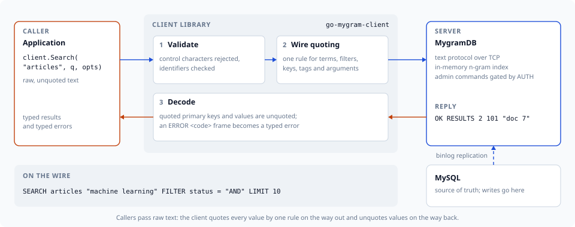

# Getting Started

This guide walks through connecting to a MygramDB server and running your first
queries with `go-mygram-client`.



## Prerequisites

- Go 1.26 or newer
- A running MygramDB server

## Installation

```bash
go get github.com/libraz/go-mygram-client
```

The client depends only on the Go standard library.

## Basic Setup

### 1. Import the package

The module is imported under the package name `mygram`:

```go
import mygram "github.com/libraz/go-mygram-client"
```

### 2. Create a client

`NewClient` accepts a `host:port` address (or a Unix socket path):

```go
client := mygram.NewClient("localhost:11016")
```

> **Client vs Pool.** A `Client` owns a single connection and serializes
> commands, so it handles one request at a time and must be connected explicitly
> (below). Most applications should use a [`Pool`](advanced-usage.md#connection-pooling)
> instead — it manages many connections with reconnection and retry, connects
> lazily, and exposes the same command methods. Reach for `Client` directly only
> when you want to own and control a single connection.
>
> An address that does not parse as `host:port` (e.g. a bare `localhost` with no
> port) is treated as a Unix socket path.

For finer control, pass a `ClientConfig` to `NewClientWithConfig`:

```go
client := mygram.NewClientWithConfig(mygram.ClientConfig{
    Host:      "192.168.1.100",
    Port:      11016,
    TimeoutMs: 10000,
})
```

### 3. Connect

```go
if err := client.Connect(); err != nil {
    log.Fatal(err)
}
defer client.Close()
```

Every command also has a `Context` variant (for example `ConnectContext`) that
accepts a `context.Context` for per-call deadlines and cancellation.

### 4. Run commands

```go
// Search
resp, err := client.Search("articles", "hello world", mygram.SearchOptions{Limit: 10})

// Count matches without fetching IDs
cnt, err := client.Count("articles", "technology", mygram.CountOptions{})

// Fetch a document by primary key
doc, err := client.Get("articles", "12345")
```

## Complete Example

```go
package main

import (
    "fmt"
    "log"

    mygram "github.com/libraz/go-mygram-client"
)

func main() {
    client := mygram.NewClient("localhost:11016")

    if err := client.Connect(); err != nil {
        log.Fatal(err)
    }
    defer client.Close()

    resp, err := client.Search("articles", "golang tutorial", mygram.SearchOptions{
        Limit:      10,
        SortColumn: "created_at",
        SortDesc:   true,
    })
    if err != nil {
        log.Fatal(err)
    }

    fmt.Printf("Found %d results\n", resp.TotalCount)
    for _, r := range resp.Results {
        fmt.Printf("- %s\n", r.PrimaryKey)
    }
}
```

## Configuration Options

`ClientConfig` (used by `NewClientWithConfig`) accepts the following fields.
`DefaultConfig()` returns the defaults, and any zero-valued field is filled in
with its default.

| Field | Type | Default | Description |
|-------|------|---------|-------------|
| `Host` | string | `"127.0.0.1"` | Server hostname or IP address |
| `Port` | int | `11016` | Server port number |
| `SocketPath` | string | — | Unix domain socket path; takes priority over TCP when set |
| `TimeoutMs` | int | `5000` | Command timeout in milliseconds |
| `RecvBufferSize` | int | `65536` | Receive buffer size in bytes |
| `MaxQueryLength` | int | `128` | Maximum query expression length before validation fails; `0` disables the check |
| `MaxResponseSize` | int | `0` | Maximum accepted response size in bytes; `0` is unlimited. A bounded value (e.g. `64<<20`) guards against a runaway response exhausting memory |

`ClientConfig` also carries resilience fields — `AutoReconnect`,
`DisableTCPKeepAlive`, and `TCPKeepAliveIdle` — covered in
[Advanced Usage](advanced-usage.md#tcp-keep-alive) and the
[API Reference](api-reference.md#clientconfig).

## Error Handling

Commands return concrete error types you can match with `errors.As`:

```go
import "errors"

resp, err := client.Search("articles", "test", mygram.SearchOptions{})
if err != nil {
    var connErr *mygram.ConnectionError
    var protoErr *mygram.ProtocolError
    var timeoutErr *mygram.TimeoutError
    var valErr *mygram.ValidationError
    var srvErr *mygram.ServerError

    switch {
    case errors.As(err, &connErr):
        log.Println("connection failed:", connErr)
    case errors.As(err, &timeoutErr):
        log.Println("request timed out:", timeoutErr)
    case errors.As(err, &valErr):
        log.Println("invalid input:", valErr)
    case errors.As(err, &srvErr):
        // srvErr.Code is the server's numeric error code (MygramDB 1.10+);
        // ErrCodeNone on an older server.
        log.Println("server returned an error:", srvErr)
    case errors.As(err, &protoErr):
        log.Println("protocol error:", protoErr)
    default:
        log.Println("unexpected error:", err)
    }
}
```

See the [API Reference](api-reference.md#error-types) for the full list of error
types and [Server error codes](api-reference.md#server-error-codes) for the
numeric codes a server attaches to every `ERROR` frame (MygramDB 1.10 or
later).

`TimeoutError` also satisfies `net.Error` (its `Timeout()` reports `true`), and a
command that times out because your `context` deadline elapsed wraps
`context.DeadlineExceeded`, so both of these match:

```go
var ne net.Error
if errors.As(err, &ne) && ne.Timeout() { /* any timeout */ }
if errors.Is(err, context.DeadlineExceeded) { /* caused by the ctx deadline */ }
```

## Next Steps

- [API Reference](api-reference.md) — every method, option, and type
- [Search Expressions](search-expression.md) — parse web-style search input
- [Advanced Usage](advanced-usage.md) — connection pooling, resilience features
  (circuit breaker, observability, TCP keep-alive, auto-reconnect),
  administrative `AUTH`, error codes, search features (BM25 relevance, fuzzy
  matching, highlighting, facets, comparison filters, boolean query mode, raw
  boolean search), multi-database tables, and production patterns

## Troubleshooting

### Connection refused

- Confirm the MygramDB server is running and reachable.
- Verify the host and port (or `SocketPath`) are correct.
- Check that no firewall blocks the connection.

### Timeout errors

- Increase `TimeoutMs` in `ClientConfig`.
- Inspect server load and network latency.
- Use a `Context` variant with an explicit deadline for per-call control.

### Validation errors

A `*ValidationError` means the client rejected the input before sending it —
typically a control character (CR/LF) inside a table name, query, or filter
value, or a query whose combined expression length exceeds `MaxQueryLength`.
Fix the input, or raise `MaxQueryLength` (and the server-side
`api.max_query_length`) if longer expressions are legitimately required.
