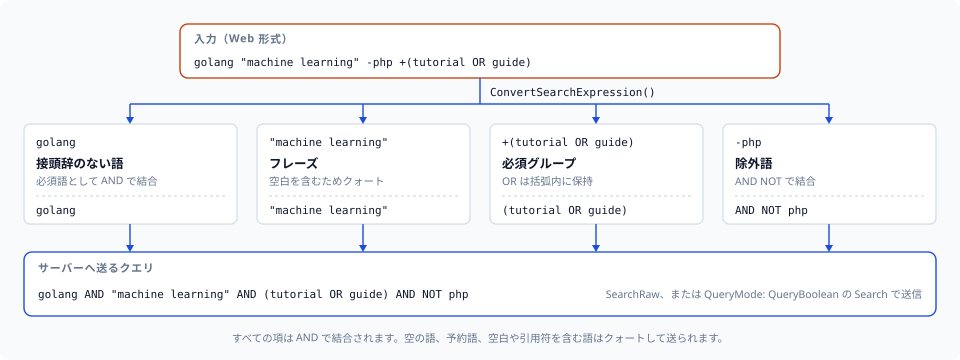

# 検索式

このクライアントには、Web スタイルの検索入力（おなじみの
`+required -excluded "phrase" OR (grouping)` 構文）を MygramDB が理解できる
term やクエリ文字列に変換するパーサーが同梱されています。純粋な Go 実装で
サーバーに依存しないため、信頼できないユーザー入力を、どうクエリするか決める
前に解析できます。

## 構文

| 構文 | 意味 | 例 |
|--------|---------|---------|
| `+term` | 必須の term（必ず含まれる） | `+golang` |
| `-term` | 除外する term（含まれてはならない） | `-deprecated` |
| `term1 term2` | 複数の term（暗黙の AND） | `golang tutorial` |
| `"phrase"` | 引用符付きフレーズ（完全一致） | `"hello world"` |
| `(expr)` | グループ化 | `(python OR ruby)` |
| `term1 OR term2` | 論理 OR | `golang OR rust` |

これらは組み合わせられます。例えば次のように書けます。

```
+golang +(tutorial OR guide) -deprecated "best practices"
```



```go
mygram.ConvertSearchExpression(`golang "machine learning" -php +(tutorial OR guide)`)
// `golang AND "machine learning" AND (tutorial OR guide) AND NOT php`
```

## 関数

### SimplifySearchExpression

```go
func SimplifySearchExpression(expression string) (*SimplifiedExpression, error)
```

式を、`SearchOptions` に直接対応するメインの term と AND/NOT の term リストに
分解します。単純な入力（`OR` やグループ化を含まない）に使ってください。

```go
expr, err := mygram.SimplifySearchExpression("+golang tutorial -old -deprecated")
// expr.MainTerm == "golang"
// expr.AndTerms == []string{"tutorial"}
// expr.NotTerms == []string{"old", "deprecated"}

resp, err := client.Search("articles", expr.MainTerm, mygram.SearchOptions{
    AndTerms: expr.AndTerms,
    NotTerms: expr.NotTerms,
})
```

`SimplifiedExpression` は 3 つのフィールドを持ちます。

```go
type SimplifiedExpression struct {
    MainTerm string   // primary keyword
    AndTerms []string // additional required keywords
    NotTerms []string // excluded keywords
}
```

`OR` またはグループ化を含む式は `*ValidationError` として拒否されます。
`MainTerm`/`AndTerms`/`NotTerms` には論理 `OR` を表現する手段がなく、
`MainTerm` を利用する側は皆それをワイヤ用に再度引用符で括るため、すでに
`"(a OR b)"` の形に組み立てられたテキストを不透明な1つのリテラルフレーズに
してしまい、`OR` として解釈されなくなります。その場合は
[`ConvertSearchExpression`](#convertsearchexpression) と
[`SearchRaw`](api-reference.md#searchraw) を使ってください。

### ConvertSearchExpression

```go
func ConvertSearchExpression(expression string) (string, error)
```

式を MygramDB のクエリ文字列に変換します。各 term は必要に応じてワイヤ用に
引用符で括られます — 空、句のキーワードと一致する、あるいは空白・引用符・
バックスラッシュ・括弧を含む場合です（[補足](#補足)を参照）。単純な式は
`AND`/`NOT` 形式に平坦化され、`OR` やグループ化を含む式はその部分がブール
構文のテキストとして括弧で括られ、サーバーのブールパーサーが解釈できる形に
なります。

```go
mygram.ConvertSearchExpression("+golang +tutorial") // "golang AND tutorial"
mygram.ConvertSearchExpression("+golang -old")      // "golang AND NOT old"
mygram.ConvertSearchExpression("python OR ruby")    // "(python OR ruby)"
mygram.ConvertSearchExpression("golang not")        // `golang AND "not"` — 単独の "not" は NOT キーワードと衝突する
```

結果を [`SearchRaw`](api-reference.md#searchraw) に渡すと、`Search` の AND/NOT
分解では表現できないブールクエリを実行できます。

```go
raw, _ := mygram.ConvertSearchExpression("python OR (ruby rails)")
resp, _ := client.SearchRaw("articles", raw, mygram.SearchRawOptions{Limit: 50})
```

### ParseSearchExpression

```go
func ParseSearchExpression(expression string) (*SearchExpression, error)
```

完全に構造化された解析ツリーを返します。分類された term を直接検査したい
場合に使ってください。

```go
type SearchExpression struct {
    RequiredTerms []string // every term that must match: '+'-prefixed and unprefixed (implicit AND), in original order
    ExcludedTerms []string // terms marked with -
    OptionalTerms []string // unused; kept for source compatibility
    RawExpression string   // reconstructed boolean-syntax text for a bare OR chain or group, already wire-quoted
}
```

### HasComplexExpression

```go
func HasComplexExpression(expr *SearchExpression) bool
```

解析済みの式が `OR` またはグループ化を含むか（すなわち、単純な AND/NOT の
term に簡約できないか）を報告します。

### ToQueryString

```go
func ToQueryString(expr *SearchExpression) string
```

解析済みの `SearchExpression` を MygramDB のクエリ文字列に戻します。
`ConvertSearchExpression` と同じ term ごとのワイヤ用引用符付け判断が適用されます。
空でない `RawExpression` は括弧で括られ、必須/除外の term と AND で結合されます。

## 適切な経路の選択

小さなヘルパーで、単純な経路とブールの経路を自動的に選び分けられます。

```go
func smartSearch(client *mygram.Client, table, input string, opts mygram.SearchOptions) (*mygram.SearchResponse, error) {
    parsed, err := mygram.ParseSearchExpression(input)
    if err != nil {
        return nil, err
    }

    if mygram.HasComplexExpression(parsed) {
        raw, err := mygram.ConvertSearchExpression(input)
        if err != nil {
            return nil, err
        }
        return client.SearchRaw(table, raw, mygram.SearchRawOptions{
            Limit:  opts.Limit,
            Offset: opts.Offset,
        })
    }

    simple, err := mygram.SimplifySearchExpression(input)
    if err != nil {
        return nil, err
    }
    opts.AndTerms = append(opts.AndTerms, simple.AndTerms...)
    opts.NotTerms = append(opts.NotTerms, simple.NotTerms...)
    return client.Search(table, simple.MainTerm, opts)
}
```

## SEARCH コマンドの組み立て方

`SearchOptions` のオプションは、次のように MygramDB の各句へ対応します。

### フィルタ

`Filters` の各エントリは独立した `FILTER key = value` 句になります。フィルタは
`AND` で連結されるのではなく、サーバー側で結合されます。

```go
client.Search("articles", "golang", mygram.SearchOptions{
    Filters: map[string]string{"status": "published", "lang": "en"},
})
// SEARCH articles golang FILTER status = published FILTER lang = en LIMIT 1000
```

`Filters` は `map` のため、複数のフィルタを指定した場合、ワイヤ上の `FILTER` 句
の相対順序は保証されません。

### ページネーション

`Limit` と `Offset` は MySQL 形式の `LIMIT` にコンパイルされます。

- `Limit` > 0 かつ `Offset` が 0 のとき `LIMIT count`
- `Limit` と `Offset` の両方が設定されているとき `LIMIT offset,count`
- `Offset` のみ設定されているとき `OFFSET offset`（`LIMIT` なし）
- `Limit` と `Offset` の両方が 0 のとき `LIMIT 1000`（従来のデフォルト）

### ソート

`SortColumn` と `SortDesc` は `SORT` 句（`SORT column ASC|DESC`）にコンパイル
されます。`SortDesc` はゼロ値のとき昇順で、降順にするには `true` を設定します。
`SortColumn` を空のままにすると主キー順でソートされ、`"_score"` を設定すると
BM25 の関連度順でソートされます（[高度な使い方](advanced-usage.md#bm25-関連度スコアリング)
を参照）。

### 組み合わせた例

```go
resp, _ := client.Search("articles", "hello world", mygram.SearchOptions{
    AndTerms:   []string{"programming"},
    NotTerms:   []string{"deprecated"},
    Filters:    map[string]string{"status": "published", "lang": "en"},
    SortColumn: "created_at",
    SortDesc:   true,
    Limit:      20,
    Offset:     40,
})
// SEARCH articles "hello world" AND programming NOT deprecated
// FILTER status = published FILTER lang = en SORT created_at DESC LIMIT 40,20
```

## 補足

- `"hello world"` のような引用符付きフレーズは1つの term として解析されます
  （外側の引用符は取り除かれます）。フレーズを開始できるのは `"` だけで、
  アポストロフィ（`don't`）は term 内のリテラル文字として扱われ、引用符の
  開始とはみなされません。`OR` は大文字小文字を区別せず単語単位で認識され
  ます（`or`、`Or`、`OR`）。
- term は、空である、句のキーワード（`AND`、`OR`、`NOT`、`FILTER`、`SORT`、
  `LIMIT`、`OFFSET`、`HIGHLIGHT`、`FUZZY`、`FACET`、`ORDER` のいずれかと
  大文字小文字を区別せず一致する）、あるいは ASCII/Unicode の空白、`"`、
  `'`、`\`、`(`、`)` のいずれかを含む場合にワイヤ上で引用符付けされます。
  呼び出し側は常に生の未引用テキストを渡せばよく、引用符付けは自動的かつ
  可逆的に行われます。
- 括弧付きグループ内の `-` はリテラルな単語 `NOT` としてレンダリングされます。
  サーバーのブールパーサーには単独の `-` に対応する演算子の意味がないためです。
- パーサーは、対応の取れない括弧や閉じられていない引用符をエラーとして拒否
  します。信頼できない入力の解析はそれに応じてラップしてください。
- クライアント経由で送られる入力は、サーバーに届く前に制御文字と長さが検証
  されます（設定オプション `MaxQueryLength` を参照）。
